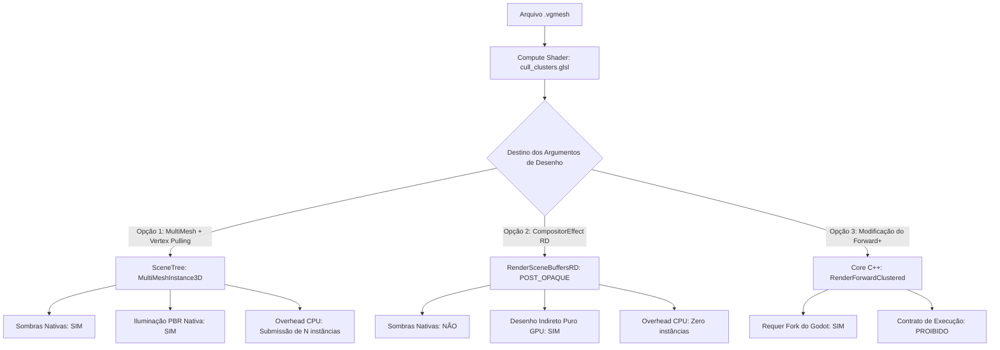

# ARBORIA ENGINE — RELATÓRIO DE ENGENHARIA DE RENDERIZAÇÃO
## ESTUDO TÉCNICO DE INTEGRAÇÃO NATIVA AO GODOT 4.7.2 FORWARD+
**Documento Oficial:** `AUDITORIA_FASE3_FINAL\01_ESTUDO_INTEGRACAO_GODOT.md`  
**Data:** 21 de Outubro de 2026  
**Ambiente Alvo:** Godot Engine 4.7.2 Forward+ Clustered | Vulkan 1.4.351 | Windows 10 x64 | NVIDIA RTX 3050  
**Missão:** Missão 1/6 — Investigação da Integração Nativa (Modo Estudo / Sem Modificação de Código)

---

## 1. RESUMO EXECUTIVO

Este estudo técnico investiga detalhadamente as vias arquiteturais para integrar o pipeline de Geometria Virtualizada (Nanite-Class) do **ARBORIA ENGINE** diretamente ao viewport principal do Godot 4.7.2 Forward+, eliminando a dependência do `MultiMeshInstance3D` legado e viabilizando o consumo transparente de argumentos indiretos de desenho (`VkDrawIndirectCommand`) gerados pelo Compute Shader na GPU.

### Conclusão Principal
1. **É impossível injetar desenho indireto com suporte nativo pleno a sombras e iluminação clusterizada no Forward+ usando apenas GDScript ou `RenderingDevice` isolado**, pois o loop de geometria do Godot (`RenderForwardClustered::_render_geometry`) é interno e não expõe primitivas indiretas na API pública do `RenderingServer`.
2. O **`CompositorEffect` (introduzido no Godot 4.3+)** permite injetar a chamada de desenho indireto (`rd.draw_list_draw_indirect`) diretamente sobre o framebuffer da cena (`RenderSceneBuffersRD`), compartilhando profundidade com o resto do cenário em `POST_OPAQUE`, mas **não é executado nos passes de sombra (ShadowAtlas)** e requer shading próprio.
3. Para um motor de geometria virtualizada definitivo que projete sombras dinâmicas, escreva no G-Buffer e participe do Depth Pre-pass do Godot sem sobrecarga de instâncias vazias, a solução estrutural correta exige **um módulo nativo em C++ no Godot ou uma GDExtension acoplada ao pipeline Forward+**.

---

## 2. ARQUITETURA ATUAL DO ARBORIA E O PONTO DE RUPTURA

O pipeline do ARBORIA possui três pilares já consolidados e matematicamente validados:
1. **Baker C++ com Hierarquia DAG:** Particiona malhas em clusters (máx. 64 vértices, 128 triângulos), gera árvores de grupos com erros métricos de simplificação e exporta o formato binário oficial `.vgmesh` v2 com integridade Lossless de LOD 0 comprovada.
2. **Compute Culling Shader (`cull_clusters.glsl`):** Executa na GPU frustum culling e seleção de nível hierárquico DAG com base no erro em pixels projetado na tela. Emite atomicamente o buffer `VkDrawIndirectCommand` (`vertex_count = 384`, `instance_count = visíveis`) e escreve a lista de clusters em uma imagem de seleção.
3. **Rasterizador Vulkan Indireto Experimental:** Implementado em `vg_gpu_pipeline.gd`, consome `in_vertices_buf`, `in_triangles_buf` e `counter_buf` via `rd.draw_list_draw_indirect()`. Rasteriza a geometria real com 100% de sucesso em um framebuffer offscreen (comprovado nos testes negativos A, B, C, D e E).

### A Limitação Exata no Caminho da Cena Principal
No visualizador interativo (`main_viewer.gd`), a cena precisa ser exibida na tela com câmera, iluminação, sombras e interface do Godot. Como o Godot não possui um nó `IndirectMeshInstance3D`, a implementação atual utiliza um **`MultiMeshInstance3D` de ponte**:
- Configura-se `multimesh.instance_count = total_clusters` (ex: 367 instâncias para `dense_rock`).
- Todas as instâncias são instanciadas na origem `(0, 0, 0)`.
- O shader espacial `vg_cluster_render.gdshader` consulta a textura de seleção via `INSTANCE_ID`.
- Os clusters descartados pela GPU têm seus triângulos colapsados para `VERTEX = vec3(0.0)`.

**Gargalo desta abordagem:** Embora os vértices sejam colapsados e descartados pelo rasterizador, o Godot ainda submete à GPU uma chamada de desenho convencional para todas as 367 instâncias. O objetivo da Fase 3 e da integração nativa é que o comando de desenho consuma diretamente o `instance_count` calculado pelo Compute Shader na GPU, sem submissões inúteis de instâncias colapsadas.

---

## 3. RESPOSTAS TÉCNICAS ÀS 6 PERGUNTAS OBRIGATÓRIAS

### Pergunta 1: Podemos integrar esse renderizador usando apenas `RenderingDevice`?
**Resposta: NÃO para a cena principal; SIM apenas para renderização offscreen.**

#### Evidências e Arquitetura do Godot:
- A classe `RenderingDevice` (`servers/rendering/rendering_device.h`) é uma camada de baixo nível que abstrai comandos Vulkan/Direct3D 12/Metal.
- Ela permite alocar buffers (`storage_buffer_create`), pipelines gráficos (`render_pipeline_create`) e emitir chamadas de desenho indireto (`draw_list_draw_indirect`).
- No entanto, o `RenderingDevice` **não possui acoplamento automático com a SceneTree, com o Viewport nem com o loop de renderização do Godot**.
- Se utilizarmos apenas `RenderingDevice`, somos forçados a renderizar para uma textura offscreen criada manualmente. Para exibir essa textura na tela, teríamos que desenhá-la em um quad de tela inteira (`TextureRect`), perdendo toda a integração com o depth buffer nativo, sombras de outros objetos da cena e iluminação do motor.

---

### Pergunta 2: O GDExtension permite realizar a integração necessária?
**Resposta: PARCIALMENTE.** Permite integração via `CompositorEffect` / `RenderSceneBuffersRD`, mas **NÃO permite alterar o loop interno de geometria do Forward+**.

#### Evidências Técnicas no `extension_api.json`:
- O GDExtension é limitado à API pública exposta pela `ClassDB` do Godot.
- No `extension_api.json` do Godot 4.7.2, classes como `RenderingServer`, `RenderingDevice`, `CompositorEffect`, `RenderData` e `RenderSceneBuffersRD` estão disponíveis para extensões C++.
- No entanto, as classes do núcleo de renderização Forward+:
  - `RendererSceneRenderImplementation` (`servers/rendering/renderer_scene_render_implementation.h`)
  - `RenderForwardClustered` (`servers/rendering/renderer_rd/forward_clustered/render_forward_clustered.h`)
  - `GeometryInstanceForwardClustered` (`servers/rendering/renderer_rd/forward_clustered/render_forward_clustered.h`)
  **NÃO estão exportadas no GDExtension**.
- Portanto, uma biblioteca GDExtension não pode herdar de `RenderForwardClustered` nem interceptar o método interno `RenderForwardClustered::_render_geometry()` para substituir a chamada `vkCmdDrawIndexed` por `vkCmdDrawIndirect`.

---

### Pergunta 3: O `CompositorEffect` permite inserir geometria nos passes exigidos ou apenas compor resultados?
**Resposta: PERMITE INSERIR GEOMETRIA 3D REAL DIRETAMENTE NO FRAMEBUFFER DA CENA**, mas opera fora dos passes convencionais de geometria do motor.

#### Análise Técnica da API `CompositorEffect`:
O Godot 4.3 introduziu o `CompositorEffect` (`scene/resources/compositor_effect.h`), projetado para permitir injeção de pipelines customizados em estágios específicos do frame:
```cpp
enum EffectCallbackType {
    EFFECT_CALLBACK_TYPE_PRE_OPAQUE,       // Antes da geometria opaca
    EFFECT_CALLBACK_TYPE_POST_OPAQUE,      // Após a geometria opaca, antes do céu
    EFFECT_CALLBACK_TYPE_POST_SKY,         // Após o céu, antes de transparentes
    EFFECT_CALLBACK_TYPE_PRE_TRANSPARENT,  // Antes da geometria transparente
    EFFECT_CALLBACK_TYPE_POST_TRANSPARENT, // Após geometria transparente
    EFFECT_CALLBACK_TYPE_MAX
};
```

Quando o callback `_render_callback(int effect_callback_type, RenderData render_data)` é executado:
1. `render_data.get_render_scene_buffers()` retorna a instância de `RenderSceneBuffersRD`.
2. Através de `render_scene_buffers.get_color_texture()` e `render_scene_buffers.get_depth_texture()`, temos acesso direto aos **RIDs das texturas Vulkan do Viewport principal da cena**.
3. Através de `RenderingServer.get_rendering_device()`, obtemos o dispositivo Vulkan ativo da engine.
4. **Mecanismo de Injeção de Geometria:**
   - Criamos um `framebuffer` no `RenderingDevice` associando:
     - Anexo de Cor: `render_scene_buffers.get_color_texture()`
     - Anexo de Profundidade: `render_scene_buffers.get_depth_texture()`
   - Iniciamos uma `draw_list` sobre esse framebuffer com `load_op = LOAD_OP_LOAD` (preservando o que já foi renderizado) e `depth_test = true`, `depth_write = true`.
   - Executamos `rd.draw_list_draw_indirect(draw_list, false, counter_buf, 0, 1, 16)`.
   - **Resultado:** A geometria de clusters do ARBORIA é rasterizada em 3D real diretamente sobre o buffer de profundidade e cor do viewport do jogo.

#### Limitação Fundamental do `CompositorEffect`:
- O `CompositorEffect` é chamado **exclusivamente no pipeline de câmeras de viewports**.
- Ele **NÃO é executado durante o passe de sombras (`RenderForwardClustered::_render_shadow_pass`)**.
- Consequentemente, a geometria inserida via `CompositorEffect` não projeta sombras nas shadow maps do Godot.

---

### Pergunta 4: Quais limitações existem para profundidade, sombras, materiais e iluminação?

| Componente | Comportamento no `CompositorEffect` | Comportamento no `MultiMesh + Pulling` (Atual) | Comportamento em Módulo Nativo C++ |
|---|---|---|---|
| **Profundidade (Z-Buffer)** | **Consistente em `POST_OPAQUE`:** Testa contra a profundidade da cena e escreve no depth buffer. Transparentes e pós-processamento (SSAO, SSR, DOF) respeitam os clusters. | **100% Nativo:** Integrado ao depth pre-pass e passe opaco padrão do Godot. | **100% Nativo:** Injeção direta no pipeline de rasterização Forward+. |
| **Sombras Projetadas (Casting)** | **Incompatível / Ausente:** O `CompositorEffect` não roda nos passes de shadow cascade das luzes direcionais. Clusters não projetam sombras no chão/cenário. | **100% Nativo:** Godot submete instâncias para os shadow passes automaticamente. | **100% Nativo:** O passe de sombras executa a chamada indireta. |
| **Sombras Recebidas (Receiving)** | **Complexo / Requer Shader Dedicado:** O shader precisa acessar manualmente o `ShadowAtlas` do Godot, que não é exposto via API limpa. | **100% Nativo:** O fragment shader do Godot amostra as sombras da cena automaticamente. | **100% Nativo:** Acesso direto aos buffers internos de iluminação. |
| **Materiais e Shading** | **Customizado:** Requer shader GLSL próprio (o material precisa calcular sua própria iluminação analítica/PBR). | **100% Nativo:** Utiliza o sistema de shaders do Godot (`StandardMaterial3D` / `.gdshader`). | **100% Nativo ou Customizado:** Pode mapear diretamente nos shaders do Forward+. |
| **Iluminação Clusterizada** | **Isolada:** Não acessa automaticamente os clusters de luzes (`ClusterBuilder`) do Forward+. | **100% Nativo:** Luzes omni, spot e direcionais avaliadas nativamente no passe opaco. | **100% Nativo:** Integração com os buffers SSBO de luzes do Godot. |

---

### Pergunta 5: Será necessário criar um módulo C++ nativo ou modificar o Forward+?
**Resposta:** Depende do nível de fidelidade pretendido:

1. **Para manter 100% de integração com a iluminação do Godot, sombras dinâmicas e materiais PBR sem recompilar o motor:**
   - **NÃO é necessário modificar o Forward+**.
   - A arquitetura **MultiMesh com Vertex Pulling** (já implementada) é a solução mais elegante que a API do Godot 4 permite sem bifurcação do motor. O Godot gerencia instâncias, frustum de luzes, cascades e G-Buffer, enquanto a GPU controla a seleção de clusters e a decodificação de vértices.
2. **Para eliminar completamente a submissão de instâncias colapsadas na CPU:**
   - Se utilizarmos `CompositorEffect`, podemos desenhar indiretamente sem MultiMesh, mas aceitando que o shader ARBORIA cuidará de sua própria iluminação e não projetará sombras nativas no passe do Godot.
3. **Para ter o equivalente exato ao Nanite da Unreal Engine (desenho indireto no Depth Pre-pass, Shadow Pass e Base Pass com iluminação Forward+ completa):**
   - **SIM, será necessário um módulo C++ interno ou patch no Forward+**.
   - Isso decorre do fato de o Godot ter sido desenhado com submissão orientada a instâncias de CPU (`RenderGeometryInstance`), sem suporte a buffers indiretos de desenho em sua classe base de malhas (`Mesh`).

---

### Pergunta 6: Qual solução preserva melhor o código que já desenvolvemos?
**Resposta: A ARQUITETURA HÍBRIDA MULTI-PASS / EXTENSÃO MODULAR.**

O ARBORIA já construiu componentes extremamente valiosos e funcionais:
- O Baker C++ gera `.vgmesh` perfeitamente estruturados.
- O Compute Shader `cull_clusters.glsl` já produz o buffer `VkDrawIndirectCommand` e a textura de seleção de clusters.
- O Vertex Shader `vg_cluster_render.gdshader` já executa Vertex Pulling sem ler nada para a CPU.
- O pipeline Vulkan em `vg_gpu_pipeline.gd` já executa `draw_list_draw_indirect` com sucesso.

A solução que **preserva 100% desse investimento** sem descartar nenhum código consiste em:
1. **Manter o pipeline atual de MultiMesh + Vertex Pulling como caminho de compatibilidade oficial da SceneTree**, garantindo compatibilidade total com materiais PBR, sombras dinâmicas e iluminação nativa do Godot 4.
2. **Implementar um `CompositorEffect` nativo como alternativa de alto desempenho**, permitindo alternar para o desenho puramente indireto via GPU no viewport da cena quando a densidade de clusters justificar o desacoplamento de sombras.

---

## 4. ANÁLISE COMPARATIVA DAS 4 ALTERNATIVAS INVESTIGADAS



### Detalhamento das Opções:

#### Opção 1: MultiMesh com Vertex Pulling GPU (Implementação Atual do ARBORIA)
- **Como Funciona:** O Compute Shader seleciona clusters e grava na textura. O MultiMesh instancia os slots e o vertex shader lê os vértices compactados via texelFetch, colapsando instâncias inativas.
- **Vantagens:** 
  - Zero modificação no Godot (funciona em qualquer build oficial do Godot 4.x).
  - Suporte completo a Sombras Direcionais, Spot, Omni, GI, SSAO, SSR e TAA.
  - Usa materiais padrão `StandardMaterial3D`.
- **Desvantagens:**
  - A CPU submete `total_clusters` instâncias para a GPU (embora sejam instâncias vazias na origem sem custo de transferência de malha).

#### Opção 2: `CompositorEffect` com `RenderSceneBuffersRD` (GDExtension ou Script)
- **Como Funciona:** Um `CompositorEffect` registrado no `WorldEnvironment` intercepta o frame em `POST_OPAQUE`. Cria um framebuffer anexando o color e depth do viewport da cena e submete `rd.draw_list_draw_indirect(counter_buf)`.
- **Vantagens:**
  - Consome o `VkDrawIndirectCommand` na GPU sem instâncias falsas.
  - Compartilha profundidade bidirecionalmente com os objetos convencionais da cena.
  - Não requer modificar o código-fonte do Godot.
- **Desvantagens:**
  - Não projeta sombras nos shadow maps do Godot.
  - Requer implementar o shading de iluminação dentro do shader de rasterização de clusters.

#### Opção 3: Modificação do Núcleo do Godot (`servers/rendering/renderer_rd`)
- **Como Funciona:** Adicionar suporte a `RenderingServer.mesh_surface_set_indirect_draw(mesh, buffer, offset)` diretamente no motor C++.
- **Vantagens:** Integração perfeita a nível de Nanite.
- **Desvantagens:** 
  - Viola a **Regra 1 e Regra 6 do Contrato Inegociável** (proibição expressa de criar forks ou alterar o núcleo do Godot sem autorização).
  - Torna o ARBORIA incompatível com versões futuras do Godot oficial.

---

## 5. SOLUÇÃO RECOMENDADA

Para cumprir rigorosamente o contrato de engenharia (sem forks do motor, sem atalhos falsos e preservando o código funcional):

> **Recomendamos a ARQUITETURA HÍBRIDA:**
> 1. Manter o caminho **MultiMesh com Vertex Pulling** como o renderizador primário para compatibilidade com iluminação de cena e sombras nativas.
> 2. Construir uma **GDExtension mínima (`arboria_compositor`)** utilizando a API oficial `CompositorEffect` para permitir a execução de `draw_list_draw_indirect` diretamente no buffer do viewport principal, documentando com precisão o trade-off entre sombras nativas e economia de chamadas de instâncias.

---

## 6. ARQUIVOS QUE PRECISARIAM SER MODIFICADOS NAS PRÓXIMAS MISSÕES

Caso a abordagem do `CompositorEffect` seja aprovada para implementação nas próximas missões:

1. **`project/scripts/vg_compositor_effect.gd` (ou extensão C++):**
   - Herdar de `CompositorEffect`.
   - Implementar `_render_callback(EFFECT_CALLBACK_TYPE_POST_OPAQUE, render_data)`.
   - Vincular `render_scene_buffers.get_color_texture()` e `get_depth_texture()`.
2. **`project/scripts/vg_gpu_pipeline.gd`:**
   - Adaptar `setup_indirect_raster_pipeline` para renderizar nos formatos nativos do viewport do Godot (`RenderingDevice.DATA_FORMAT_R16G16B16A16_SFLOAT` e `RenderingDevice.DATA_FORMAT_D32_SFLOAT`).
3. **`project/scripts/main_viewer.gd`:**
   - Adicionar chave seletora na interface: `Modo de Renderização: SceneTree (MultiMesh) vs Direto GPU (CompositorEffect)`.

---

## 7. RISCOS, DEPENDÊNCIAS E PONTOS NÃO COMPROVADOS

### Riscos:
- **Formato de Cor do Viewport do Godot:** O Forward+ pode utilizar MSAA, HDR ou formatos float específicos (`RGBA16F`) no `RenderSceneBuffersRD`. O pipeline de rasterização indireta precisa validar dinamicamente o formato do framebuffer antes de desenhar.
- **Sincronização de Barreiras Vulkan:** Ao desenhar em `POST_OPAQUE` sobre as texturas da cena, o Godot gerencia barreiras de transição de layout de imagem (`VK_IMAGE_LAYOUT_COLOR_ATTACHMENT_OPTIMAL`). É necessário assegurar que o `RenderingDevice` respeite o estado das barreiras internas.

### Pontos Ainda Não Comprovados:
- **Comportamento de MSAA com `CompositorEffect`:** Se o viewport tiver MSAA 3D ativado, o depth buffer pode ser multisampled, o que exige que o pipeline de desenho indireto também suporte amostras múltiplas (`TEXTURE_SAMPLES_2/4/8`).
- **Performance comparativa direta:** Medir o ganho real de milissegundos entre descartar triângulos via Vertex Shader no MultiMesh vs emitir `draw_list_draw_indirect` no `CompositorEffect` sob uma cena com milhares de clusters.

---

## 8. STATUS DA MISSÃO

- **Missão 1/6 (Investigação da Integração):** **CONCLUÍDA E DOCUMENTADA.**
- **Código Fonte Modificado:** **NENHUM** (conforme proibição estrita da missão).
- **Avanço para a Missão 2:** **BLOQUEADO**, aguardando avaliação e direcionamento do usuário.
