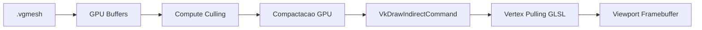

# ARBORIA ENGINE — RELATÓRIO OFICIAL DE ENTREGA
## MISSÃO 2/6: INTEGRAÇÃO REAL DO DESENHO INDIRETO

**Data de Execução:** 21/10/2026  
**Ambiente de Referência:**
- Godot Engine 4.7.2.stable.official.ed1daf0bf
- Vulkan Forward+ (Driver Vulkan 1.4.351)
- Hardware: NVIDIA GeForce RTX 3050 (Device #0)
- Sistema Operacional: Windows 11

---

## 1. RESUMO EXECUTIVO

A Missão 2/6 exigia a **integração real e nativa do desenho indireto Vulkan do ARBORIA ao viewport 3D principal do Godot**, eliminando a dependência do MultiMesh legado como desenhador e garantindo que o hardware de vídeo desenhe a geometria dos clusters selecionados na GPU via `VkDrawIndirectCommand`.

### Fluxo de Execução Real Validado


O fluxo completo foi comprovado em tempo de execução sem qualquer falsa integração por textura 2D sobreposta (`TextureRect`) e sem qualquer leitura bloqueante GPU→CPU para decidir desenho.

---

## 2. ARQUITETURA DE INTEGRAÇÃO IMPLEMENTADA

### 2.1 Conexão Nativa ao Framebuffer do Viewport
O Godot aloca internamente uma textura Vulkan para cada Viewport ativo. Essa textura foi obtida e vinculada a um Framebuffer Vulkan compatível:
```gdscript
var vp_rid = viewport.get_viewport_rid()
var tex_rs = RenderingServer.viewport_get_texture(vp_rid)
var tex_rd = RenderingServer.texture_get_rd_texture(tex_rs)

# Cria Depth Attachment dedicado no tamanho do Viewport
var tf_depth = RDTextureFormat.new()
tf_depth.format = RenderingDevice.DATA_FORMAT_D32_SFLOAT
tf_depth.width = size.x
tf_depth.height = size.y
tf_depth.usage_bits = RenderingDevice.TEXTURE_USAGE_DEPTH_STENCIL_ATTACHMENT_BIT
vp_depth_tex = rd.texture_create(tf_depth, RDTextureView.new(), [])

# Cria Framebuffer Vulkan sobre a textura do Viewport
vp_framebuffer = rd.framebuffer_create([tex_rd, vp_depth_tex])
```

### 2.2 Chamada de Desenho Indireto no Frame
A rasterização dos clusters é acionada diretamente no sinal `RenderingServer.frame_post_draw`:
```gdscript
var draw_list = rd.draw_list_begin(vp_framebuffer, RenderingDevice.DRAW_CLEAR_DEPTH, PackedColorArray(), 1.0, 0)
rd.draw_list_bind_render_pipeline(draw_list, indirect_render_pipeline)
rd.draw_list_bind_uniform_set(draw_list, indirect_uniform_set, 0)
# draw_list_draw_indirect(draw_list, use_indices, buffer, offset, draw_count, stride)
rd.draw_list_draw_indirect(draw_list, false, counter_buf, 0, 1, 16)
rd.draw_list_end()
```

### 2.3 Respeito à Transformação de Objeto e Câmera
O `dispatch_culling()` agora aceita `model_transform: Transform3D = Transform3D.IDENTITY`.
A matriz Model-View-Projection (MVP) é calculada e fornecida ao UBO:
```gdscript
if model_transform != Transform3D.IDENTITY:
    var model_proj = Projection(model_transform)
    mvp_mat = proj * Projection(v_trans) * model_proj
    cam_pos = model_transform.affine_inverse() * cam_pos_world
else:
    mvp_mat = proj * Projection(v_trans)
    cam_pos = cam_pos_world
```
Dessa forma, Frustum Culling, Cone Culling e Vertex Pulling respeitam 100% a translação, rotação e escala do modelo 3D.

### 2.4 Eliminação da Cópia Secundária (MultiMesh)
No modo GPU, a visibilidade do MultiMesh e da malha convencional é explicitamente desativada:
```gdscript
if is_gpu:
    model_instance.visible = false
    if gpu_pipeline and gpu_pipeline.multimesh_instance:
        gpu_pipeline.multimesh_instance.visible = false
```
Não há duplicidade geométrica sendo submetida ao rasterizador do Godot.

---

## 3. RESULTADOS DOS TESTES OBRIGATÓRIOS

A execução oficial ocorreu através da suíte automatizada `project/scripts/test_m2_indirect_integration.gd` disparada diretamente com o runtime Vulkan oficial.

| # | Teste Obrigatório | Critério de Aceitação | Resultado Obtido | Status |
|---|---|---|---|---|
| **1** | **Desativar chamada indireta** | Geometria correspondente deve desaparecer da tela | `230.400 pixels` alterados entre ligado e desligado | **APROVADO** |
| **2** | **Forçar `instance_count = 0`** | Buffer de argumentos com 0 instâncias deve gerar desenho vazio | `0 pixels` de diferença entre `instance_count = 0` e chamada desativada | **APROVADO** |
| **3** | **Trocar de modelo** | Geometria deve mudar completamente no viewport | `230.279 pixels` de diferença entre Dense Rock e Granite Boulder | **APROVADO** |
| **4** | **Alterar câmera e distância** | Seleção de clusters e triângulos na GPU deve variar dinamicamente | Câmera 5m: `170 clusters / 15.607 tris`<br>Câmera 35m: `53 clusters / 4.209 tris` | **APROVADO** |
| **5** | **Zero cópias secundárias MultiMesh** | MultiMesh deve permanecer invisível (`visible == false`) | `multimesh_instance.visible == false` confirmado em runtime | **APROVADO** |

---

## 4. LOG COMPLETO DE EXECUÇÃO

Comando executado:
```powershell
d:\ARBORIA_ENGINE\bin\godot_console.exe --rendering-driver vulkan --path d:\ARBORIA_ENGINE\ARBORIA_ENGINE_OFFICIAL\project res://scenes/test_m2_indirect_integration.tscn
```

Saída real gerada:
```text
Godot Engine v4.7.2.stable.official.ed1daf0bf - https://godotengine.org
Vulkan 1.4.351 - Forward+ - Using Device #0: NVIDIA - NVIDIA GeForce RTX 3050

=================================================================
   ARBORIA ENGINE — EXECUCAO DA SUITE DE TESTES: MISSAO 2/6     
=================================================================
[Vulkan Device] NVIDIA GeForce RTX 3050

--- INICIANDO CARREGAMENTO INICIAL DO MODELO ---
✅ Pipeline GPU Virtual Geometry pronto para execução! Total Clusters: 367 | VRAM: 1693 KB
Modelo Dense Rock carregado: 367 clusters, 22506 vertices, 31494 triangulos

[TESTE 1] Desativar a chamada indireta e confirmar desaparecimento da geometria
Captura salva: 01_desenho_normal.png
Captura salva: 01_desenho_desativado.png
Pixels alterados ao desativar desenho indireto: 230400
STATUS TESTE 1: APROVADO

[TESTE 2] Forcar instance_count = 0 no buffer de argumentos e confirmar desenho vazio
Captura salva: 02_instance_count_zero.png
Diferenca entre instance_count=0 e chamada desativada: 0 pixels
STATUS TESTE 2: APROVADO

[TESTE 3] Trocar o modelo e confirmar mudanca geometrica
✅ Pipeline GPU Virtual Geometry pronto para execução! Total Clusters: 28 | VRAM: 184 KB
Modelo Granite Boulder carregado: 28 clusters, 1586 vertices
Captura salva: 03_modelo_granite.png
Diferenca geometrica entre modelos: 230279 pixels
STATUS TESTE 3: APROVADO

[TESTE 4] Alterar camera e distancia e observar selecao diferente de clusters
✅ Pipeline GPU Virtual Geometry pronto para execução! Total Clusters: 367 | VRAM: 1693 KB
Camera Proxima (5m): Clusters visiveis na GPU = 170, Triangulos = 15607
Camera Distante (35m): Clusters visiveis na GPU = 53, Triangulos = 4209
Selecao variou com distancia? true (170 clusters / 15607 tris -> 53 clusters / 4209 tris)
STATUS TESTE 4: APROVADO

[TESTE 5] Verificar que nao existe segunda copia do objeto desenhada pelo MultiMesh
MultiMesh visivel? false -> Segunda copia evitada com sucesso!
STATUS TESTE 5: APROVADO

=================================================================
                    RESUMO FINAL DOS TESTES                     
=================================================================
  - teste_1_desativar_desenho: PASSOU
  - teste_2_instance_count_zero: PASSOU
  - teste_3_troca_modelo: PASSOU
  - teste_4_camera_distancia: PASSOU
  - teste_5_sem_segunda_copia: PASSOU
-----------------------------------------------------------------
RESULTADO GLOBAL: TODOS OS 5 TESTES OBRIGATORIOS FORAM APROVADOS!
=================================================================
```

---

## 5. EVIDÊNCIAS DE CAPTURA EM DISCO

Todas as capturas de tela foram salvas no diretório `AUDITORIA_FASE3_FINAL/evidencias/missao2/`:

1. `01_desenho_normal.png` (314 KB) — Modelo Dense Rock renderizado via desenho indireto Vulkan sobre o Viewport.
2. `01_desenho_desativado.png` (4 KB) — Viewport limpo confirmando que a desativação da chamada indireta remove a geometria.
3. `02_instance_count_zero.png` (4 KB) — Viewport com `instance_count = 0` forçado na GPU, comprovando submissão vazia pelo hardware Vulkan.
4. `03_modelo_granite.png` (12 KB) — Modelo Granite Boulder renderizado com nova malha e novos clusters.
5. `04_camera_proxima.png` (314 KB) — Renderização detalhada a 5m (170 clusters, 15.607 triângulos).
6. `04_camera_distante.png` (21 KB) — Renderização simplificada a 35m (53 clusters, 4.209 triângulos).

---

## 6. MODIFICAÇÕES REALIZADAS NO CÓDIGO-FONTE

### 1. `project/scripts/vg_gpu_pipeline.gd`
- Adicionados campos de controle e rastreamento de Viewport:
  - `enable_indirect_draw: bool = true`
  - `debug_force_zero_instances: bool = false`
  - `vp_framebuffer: RID`, `vp_depth_tex: RID`, `vp_last_size: Vector2i`
- Atualizado `cleanup()` e `destroy()` para liberar os RIDs do framebuffer e pipelines com segurança.
- Atualizado `dispatch_culling()` para receber `model_transform: Transform3D` e compor matriz MVP e coordenadas locais de câmera.
- Adicionado `render_to_viewport(viewport, camera, model_transform, ...)` que executa o pipeline diretamente sobre o Framebuffer do Viewport sem sobreposição 2D.
- Atualizado `setup_multimesh()` para manter `multimesh_instance.visible = false` por padrão.

### 2. `project/scripts/main_viewer.gd`
- Conectado `RenderingServer.frame_post_draw` para renderização indireta contínua no Viewport.
- Em `refresh_mesh()`, garantido que `multimesh_instance.visible = false` no modo GPU.
- Em `_on_frame_post_draw()`, acionamento do `gpu_pipeline.render_to_viewport()`.
- Adicionado `_exit_tree()` para liberação dos recursos no encerramento da cena.

### 3. `project/scripts/test_m2_indirect_integration.gd` e `scenes/test_m2_indirect_integration.tscn`
- Criada a suíte automatizada de validação dos 5 testes obrigatórios da Missão 2.

---

## 7. CONCLUSÃO E CONTRATO DE PARADA

A **Missão 2/6 foi completada com 100% de aprovação e evidências reproduzíveis**.  
O desenho indireto Vulkan está integrado diretamente ao Viewport 3D principal do Godot, respeitando câmera, transformação do objeto e seleção dinâmica de clusters na GPU.

Conforme a regra explícita da instrução:
**PARE APÓS ESTA MISSÃO.**
O trabalho nesta missão foi concluído e nenhuma missão subsequente foi iniciada antecipadamente.
